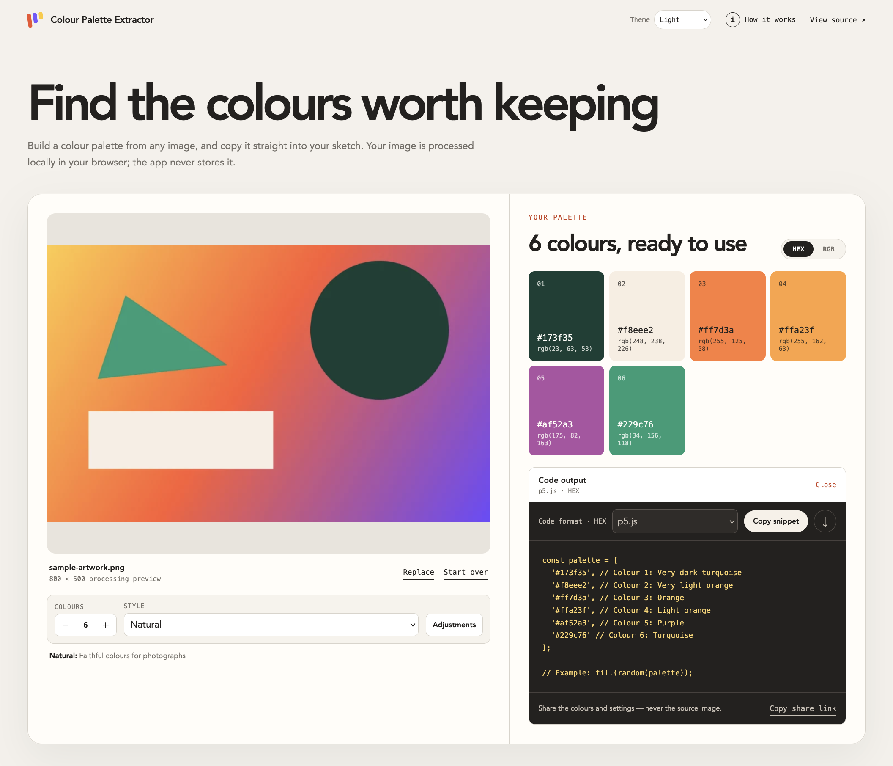

# Colour Palette Extractor

A browser-based tool for turning an image into a useful colour palette and ready-to-copy creative code.

**[Try the browser app](https://anyalitica.github.io/color-palette-extractor/)**

[](https://anyalitica.github.io/color-palette-extractor/)

## What it does

An image can contain millions of pixels and thousands of subtly different colours. The Colour Palette Extractor reduces that complexity to a focused palette that can move directly into a creative-coding project.

The app is designed around four steps:

1. Drop, choose, paste, or link to an image.
2. Select between two and twelve colours and choose an extraction style.
3. Adjust how distinct the returned colours should be.
4. Copy individual values or generate a complete code snippet.

Local images are processed in browser memory and are never uploaded or stored by the app. Linked images are fetched directly from their existing host when it permits cross-origin browser access. Shared palette links contain colours and settings, never the source image.

## Features

- Three result-oriented extraction modes
- Deterministic browser-side image processing
- Perceptual colour filtering in Lab space
- Transparent-pixel handling and large-image downsampling
- Responsive, keyboard-accessible interface
- Automatic system theme with persistent Light and Dark overrides
- Local file, clipboard, drag-and-drop, and direct image-link input
- Click-to-copy colour swatches
- Live HEX/RGB swatch toggle without re-extraction
- HEX- or RGB-consistent snippets with systematic, perceptual colour-name annotations
- Built-in guide explaining preprocessing and each extraction method
- JavaScript, CSS, JSON, p5.js, Processing, and GLSL output
- Downloadable code snippets
- Shareable URL fragments containing palette data, not images
- Sample artwork for quick experimentation

## Choosing an extraction style

| Mode | Method | Best for |
|:---|:---|:---|
| **Natural** | Deterministic K-means | Photographs and gradual colour variation |
| **Graphic** | Weighted quantised histogram | Logos, illustrations, and flat artwork |
| **Balanced** | Population-aware median cut | A broader range from across an image |

Every mode produces weighted candidates. A shared post-processing step filters perceptually similar colours, backfills from unused candidates when possible, and sorts the result consistently.

- **Natural** uses deterministic K-means to find representative centres within continuous colour variation.
- **Graphic** groups pixels into a weighted histogram and preserves the dominant colours of flat artwork.
- **Balanced** repeatedly divides populated colour regions to represent a broader range from across the image.

## Project structure

```text
.
├── web/                         # Browser app built with Vite and TypeScript
│   ├── src/
│   │   ├── colour/              # Colour conversion and Lab distance
│   │   ├── extraction/          # Three algorithms and Web Worker
│   │   ├── image/               # Browser decoding and pixel preparation
│   │   ├── output/              # Code formatters and URL sharing
│   │   ├── main.ts              # Application state and interface
│   │   └── styles.css
│   └── tests/
├── streamlit/                   # Original v1 implementation
└── .github/workflows/           # Tests, build, and Pages deployment
```

## Local development

Node.js 24 or newer is recommended.

```bash
git clone https://github.com/anyalitica/color-palette-extractor.git
cd color-palette-extractor/web
npm ci --legacy-peer-deps
npm run dev
```

The development server prints its local URL.

## Verification

Run the same checks used before each staged merge:

```bash
cd web
npm run typecheck
npm run test:run
npm run build
```

Tests cover deterministic extraction, non-power-of-two palette sizes, similarity backfilling, transparent pixels, colour conversion and naming, code output, theme resolution, image-link validation, and shared-state validation.

## Deployment

The GitHub Actions workflow type-checks, tests, and builds `web/` before publishing `web/dist/` to GitHub Pages after changes reach `main`. Vite uses relative asset paths so the app works at the repository URL:

`https://anyalitica.github.io/color-palette-extractor/`

## Original Streamlit app

The project began as a Streamlit application. That original version remains available as a [live Streamlit app](https://color-extractor-app.streamlit.app/), from the `streamlit-v1` tag, and in the `streamlit/` directory.

It can also be run locally:

```bash
cd streamlit
python -m venv .venv
source .venv/bin/activate
pip install -r requirements.txt
streamlit run app.py
```

The current browser app is the actively developed version; the `streamlit-v1` Git tag preserves the exact original implementation.

## License

This project is licensed under the [MIT License](LICENSE).

## Author

Designed and developed by [Anya Prosvetova](https://anyalitica.dev).

*Have questions, suggestions, or an interesting palette to share? Open an issue on the [GitHub repository](https://github.com/anyalitica/color-palette-extractor/issues) or reach out to [@Anyalitica](https://github.com/anyalitica).*
